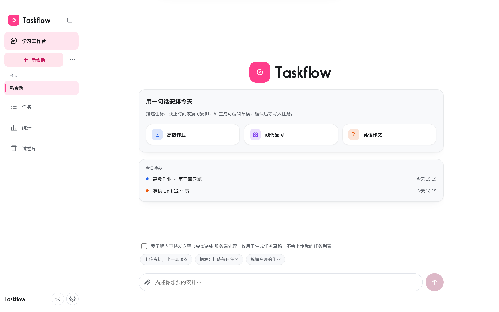
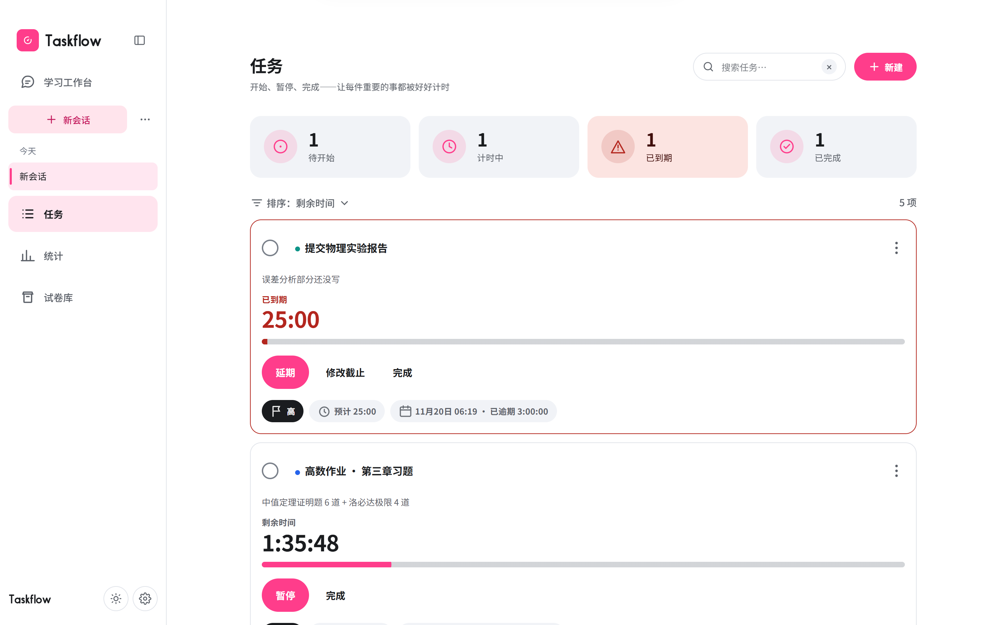
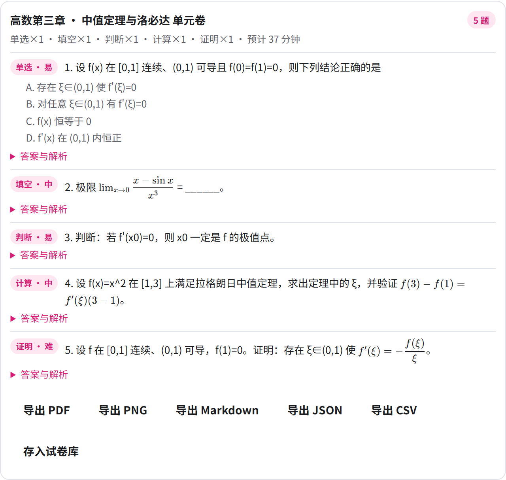
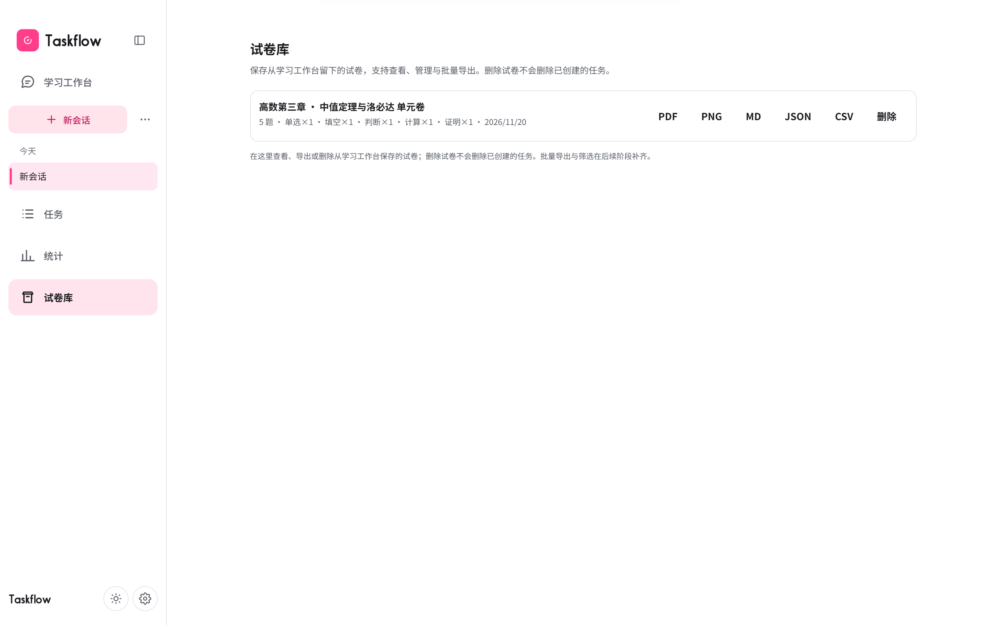
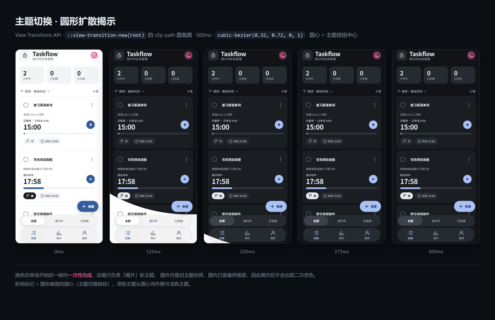
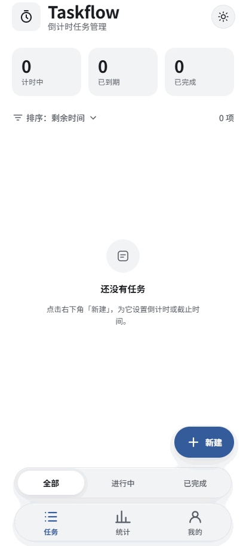
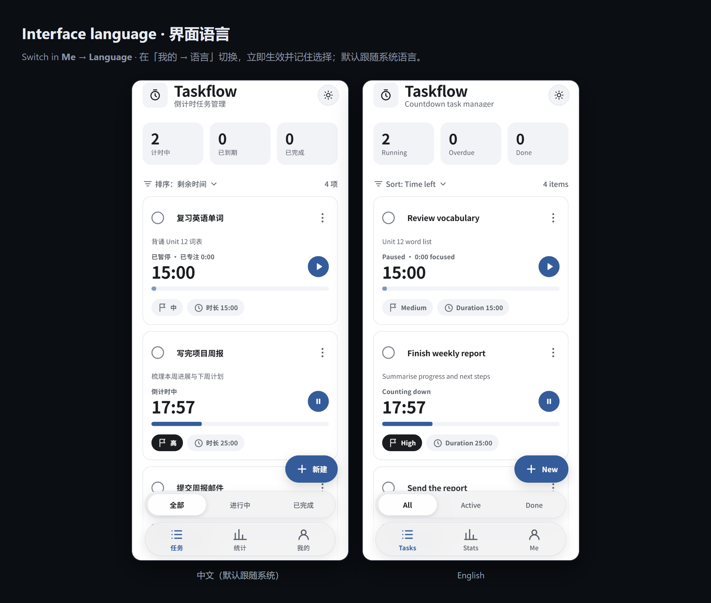

<div align="center">

# Taskflow · Turn a set of notes into a timed exam and daily tasks

**A study workbench built around one loop: notes → exam → timed tasks.**
**The same single-file app runs in the browser, as a standalone Windows exe, and inside an Android WebView shell — all byte-identical.**

[](LICENSE)
[](https://github.com/liuchenwei285/Taskflow/releases)
[](task-timer-app.html)
[](#works-without-ai)

[简体中文](README.md) · **English**

 

[⬇️ Windows exe](https://github.com/liuchenwei285/Taskflow/releases/tag/v2.6.1-windows) · [⬇️ Android APK](https://github.com/liuchenwei285/Taskflow/releases) · [🌐 Live demo](https://taskflow-app-3qo4c3iuyvd.qoder.zone/) · [Quick start](#quick-start)

</div>

---

## What it is

Most timers manage *time*. What students usually lack is not time, but *what to do with it*. Taskflow closes that gap:

> Upload notes → parse locally → AI writes questions → estimate time → confirm to create tasks → start the countdown → export the exam → save to the library

The whole chain happens in one chat box — no page hops, no forms. An exam is not the end: it carries an estimate like "37 min" and becomes a real startable / pausable / completable countdown task. **Question generation and execution live in one loop.**

| Form | Entry | Notes |
|---|---|---|
| 🌐 Online | [Qoder Sites](https://taskflow-app-3qo4c3iuyvd.qoder.zone/) | No login, no install, works on phone and desktop |
| 🪟 Windows | [v2.6.1-windows release](https://github.com/liuchenwei285/Taskflow/releases/tag/v2.6.1-windows) | Single-file exe, HTML and icon embedded, no companion files |
| 🤖 Android | [Releases](https://github.com/liuchenwei285/Taskflow/releases) | WebView shell with native notifications and theme animation, minSdk 24 |
| 📄 Local file | Open `task-timer-app.html` | Zero-dependency single file, works offline |

---

## Study studio: notes → exam → tasks

The core of this version. Say one sentence in the first-screen input and AI turns notes into an executable plan:

- **Make an exam**: upload a `.txt` / `.md` note, say "make a 5-question quiz from these notes". Get a mixed paper (multiple choice / fill-in / true-false / calculation / proof) with live KaTeX rendering and per-question time estimates.
- **Break down tasks**: say "plan tonight's homework" and AI produces an **editable draft** — nothing is written until you confirm. **No write request is sent before confirmation.**
- **Local parsing**: upload, SHA-256 content-fingerprint dedup, sectioning and preview all run in the browser; only the "generate questions" step needs AI.



Finished exams go to the library with **five real exports — PDF / PNG / Markdown / JSON / CSV**, none requiring AI; deleting an exam never deletes the tasks it created.



### AI is an accelerator, not the engine

**With no model API key configured, all of the following really work — not demo placeholders:**

- Manual creation and full lifecycle: priority, task / pomodoro dual modes, estimated duration and deadline set together; five local states (idle / running / paused / done / overdue), pauses don't count toward elapsed time, refresh keeps progress.
- Reminders and early alerts: per-task 1 / 5 / 10-minute warnings, due sound + system notification; even with permission denied an in-page alert still fires; overdue tasks can be postponed or edited.
- Organize and review: search (including IME composition path), sort, group, status filter; the stats page weekly bars and yearly heatmap come from real focus records.
- Data and experience: one-click backup export / import (auto-backup before import); dark / light themes, custom accent color, Chinese / English, reduced motion, 320px narrow screens.

To use AI, put your own model endpoint under "Settings → AI service" (OpenAI / Anthropic-compatible). The key stays in browser-local storage and requests go straight from the browser to your endpoint — **no task data is uploaded and no key lives on a frontend server**. API errors show nine actionable messages with short error codes and limited retries instead of a blank screen.

---

## Two countdowns, one state machine

The most confusing semantic pair is now split cleanly:

- **Estimated duration**: the work timer that runs only after you press start; a pause freezes it.
- **Deadline**: wall-clock time; it goes overdue on time whether or not you started.

Task cards move through five states: idle → running ⇄ paused → done / overdue. The rules are asserted in tests: pauses don't count, refresh keeps progress, overdue auto-pauses while preserving elapsed time, and done tasks are never checked for overdue.


Timing **stores timestamps, not accumulated values** — no drift across screen-off, background, or process kill:

```js
function remainingOf(t){
  if (t.status === 'running' && t.startedAt){
    const base = (t._baseRemaining != null) ? t._baseRemaining : t.remainingMs;
    return base - (now() - t.startedAt);   // recomputed from real time each call
  }
  return t.remainingMs != null ? t.remainingMs : t.durationMs;
}
```

---

## ✨ Theme switch animation

Colors are swapped once in the first frame of the transition; the animation only "reveals" the new theme. This is the most carefully crafted part of the project.



<p align="center">
  
</p>

**Reveal, don't fade**: most theme switches cross-fade old and new screens, which turns into a blurry mess on interfaces with frosted glass (`backdrop-filter`). Taskflow splits the transition in two: swap colors in one frame (old layer frozen as a snapshot, new layer already final), then clip only the new layer with `clip-path: circle(0 → R)` centered on the theme button. Inside the circle is always the finished frame — no double recolor, no translucent ghosting.

```js
const R = Math.hypot(Math.max(cx, vw - cx), Math.max(cy, vh - cy)) + 2;
root.style.setProperty('--vt-cx', cx + 'px');
root.style.setProperty('--vt-cy', cy + 'px');
const vt = document.startViewTransition(function(){
  root.classList.add('theme-switching');   // freeze all transitions/animations
  paintTheme(next);                        // swap colors once
});
vt.ready.then(function(){
  root.animate(
    { clipPath: ['circle(0px at ' + cx + 'px ' + cy + 'px)',
                 'circle(' + R + 'px at ' + cx + 'px ' + cy + 'px)'] },
    { duration: 500, easing: 'cubic-bezier(0.32, 0.72, 0, 1)', fill: 'both',
      pseudoElement: '::view-transition-new(root)' });
});
```

During the transition frosted glass is flattened (`html.theme-switching .pill { backdrop-filter:none }`) so the new layer can't sample the old snapshot. The fallback chain is complete: system animations off, no View Transitions support, `prefers-reduced-motion`, failed native capture, or an interrupted transition all fall back to a plain instant switch.

The Android shell has an equivalent native implementation: capture the window → snapshot mask with reverse hole-punch → swap theme under the mask → expand a `ValueAnimator` from the button center, sharing the same easing and 500ms duration.

---

## 🌐 Language and theme

- **Chinese / English**: 582 synchronized entries; "Me → Language" switches instantly and persists, defaulting to system language. An E2E test scans the English UI for zero Chinese residue.
- **Dark / light + custom accent**: both themes share one layout and motion system; changing the accent recolors everything. An inline `<head>` script sets `data-theme` before styles parse, so there's no white flash.
- **Material You** (Android 12+): the native side derives a palette from the wallpaper and pushes it to the page via `window.__onThemeTokens()`.



---

## 🧭 Architecture: one codebase, three forms

```
┌─ task-timer-app.html (10395 lines) ────────────────────────┐
│  Single file: all UI + logic, no framework/build/CDN        │
│  · Study studio: upload/parse / SHA-256 dedup / AI chat      │
│  · Task engine: five-state machine / timestamp timing /      │
│    pomodoro / early alerts                                   │
│  · Exam library: PDF·PNG·MD·JSON·CSV export                 │
│  · Theme / motion / tokens · stats · backup import/export    │
│  · localStorage persistence · 582 i18n entries               │
└──────────────────────────────────────────────────────────────┘
   ↑ byte-synced            ↑ embedded resource        ↑ embedded resource
┌──────────────┐  ┌──────────────────────┐  ┌────────────────────┐
│ web / Sites  │  │ windows/ WinForms    │  │ android/ WebView   │
│ static host  │  │ + WebView2 shell     │  │ native notify/theme│
└──────────────┘  └──────────────────────┘  └────────────────────┘
```

- **Windows**: `windows/` is a WinForms + WebView2 shell. The HTML and rounded icon are compiled into `Taskflow.exe` as `EmbeddedResource`, released to `%LOCALAPPDATA%\Taskflow\app\` at startup, and loaded through a `taskflow.app` virtual host — so the exe can be copied alone, no companion files, with a stable origin for localStorage.
- **Android**: the native shell does only four things — load local assets, expose `AndroidBridge`, play the theme animation, send notifications. Everything else is in the web layer, so UI issues can be debugged in browser DevTools.
- **Four HTML copies** (root / `site/` / `android/app/src/main/assets/` / `windows/app/`) are md5-locked identical.

### Focus records and stats

Every completed focus writes `{taskId, kind, startAt, endAt, ms, dateKey}`; segments crossing midnight are split so each day gets its own share. The stats page aggregates by `dateKey` into weekly bars, completion rate, priority distribution and a yearly heatmap.

### Storage and backup

Tasks / sessions / prefs are stored under separate `localStorage` keys, with runtime-only fields stripped before writing and `SCHEMA_VERSION` checked on read. Export produces `taskflow-backup-YYYYMMDD-HHMM.json` (SAF on Android, Blob download in browser); import validates the structure and auto-backs-up current data first.

---

## Quick start

### Windows standalone (easiest)

Download `Taskflow-Windows-v2.6.1.zip` from the [v2.6.1-windows release](https://github.com/liuchenwei285/Taskflow/releases/tag/v2.6.1-windows) and **double-click `Taskflow.exe`**. Requires Windows 10/11 (Edge includes the WebView2 Runtime; a clear prompt appears if missing). All local features work without an AI key.

### Online / browser

Open the [live demo](https://taskflow-app-3qo4c3iuyvd.qoder.zone/), or serve locally:

```bash
git clone https://github.com/liuchenwei285/Taskflow.git
cd Taskflow
npx serve .
# open http://localhost:3000/task-timer-app.html
```

> Double-clicking `file://` also works, but some browsers restrict `localStorage`; http is recommended.

### Android

Download the APK from [Releases](https://github.com/liuchenwei285/Taskflow/releases) and install on Android 7.0 (API 24)+.

---

## Build

### Windows exe

Requires .NET 8 SDK + Windows Desktop Runtime; the WebView2 NuGet package is restored automatically:

```bash
cd windows
python make-rounded-icon.py        # optional: regenerate rounded icon source
python make-ico.py                 # optional: build multi-size ico
dotnet publish -c Release -r win-x64 --self-contained true \
  -p:PublishSingleFile=true -p:EnableCompressionInSingleFile=true \
  -p:IncludeNativeLibrariesForSelfExtract=true -p:DebugType=None \
  -o dist/Taskflow-Windows
# output: dist/Taskflow-Windows/Taskflow.exe (single file, ~64MB)
```

After editing root `task-timer-app.html`, sync it to `windows/app/taskflow.html` before building (both must be byte-identical).

### Android APK

No Gradle — one script runs `aapt2 → javac → d8 → zipalign → apksigner`:

```bash
cd android
bash build-apk.sh
# output: dist/taskflow-v2.6.1.apk
```

The signing keystore is not in the repo (`android/keystore/` is ignored); the script generates a debug keystore on first run.

---

## Tests

```bash
npm install
npx playwright install chromium
npm test                    # starts a static server and runs all suites
```

Or individually:

```bash
node test-taskflow.js       # pure logic
node e2e-taskflow.js        # full task flow
node e2e-study.js           # study studio / AI question generation
node e2e-conversation.js    # multi-turn chat and context
node e2e-ai.js              # AI state machine (success/failure/retry/library/render)
node e2e-welcome.js         # 71 assertions: welcome dialog never touches task data
node e2e-motion.js          # motion and custom-accent red lines
node e2e-i18n.js            # zero Chinese residue in English mode
```

12 Playwright E2E suites + 1 logic regression, covering the generation chain, five-state timing, both notification paths, wide/narrow screens and Firefox / WebKit fallbacks. The Windows shell also has `windows/dev-verify.js`, which runs 8 acceptance checks in a real window over WebView2 CDP (first launch, create task, live countdown, persistence after reload).

---

## Project structure

```
Taskflow/
├─ task-timer-app.html        # single-file web app (10395 lines)
├─ site/index.html            # Sites static copy (identical to root)
├─ functions/                 # optional AI server-side proxy
├─ vendor/                    # inlined KaTeX / html2canvas for offline use
├─ i18n/en.json               # 582 English entries
├─ e2e-*.js / test-taskflow.js# 12 E2E suites + logic regression
├─ windows/                   # single-file Windows shell (WebView2)
│  ├─ Program.cs / Taskflow.csproj / app.manifest
│  ├─ icon-source-rounded-512.png / make-rounded-icon.py / make-ico.py
│  ├─ app/taskflow.html       # embedded HTML source (identical to root)
│  └─ dev-verify.js           # real-window CDP acceptance
├─ android/                   # WebView shell + build script + icon source
├─ submission/                # contest post and demo screenshots
├─ docs/                      # README assets
└─ tools/                     # static server / test runner / asset capture
```

---

## Design trade-offs and known limits

- **No CDN, works offline**: KaTeX and html2canvas are inlined into the single file; weak classroom networks, intranets, and offline local copies all render and export normally.
- **Why the exe is not committed**: a 60MB+ binary would permanently bloat git history, so build outputs are ignored and releases go to GitHub Releases.
- **AI needs your own key**: the browser talks directly to your configured endpoint and the key stays local; the built-in relay is not enabled in the public contest environment. All local features work without AI.
- **Notification small icon reuses the colorful launcher icon**: Android renders it as a monochrome silhouette, so only the shape shows in the status bar; fixing needs a dedicated `ic_stat_notify`.
- **Web theme animation depends on the View Transitions API**: unsupported browsers / WebViews switch instantly without animation, never stuck mid-transition.
- **Windows**: file export goes through the system save dialog and system-level notifications were not tested end-to-end under WebView2; in-page reminders and the timer path are verified.

---

## Contributing

Issues and PRs are welcome. Please label issues: `bug` / `ui` / `animation` / `enhancement` / `web` / `android` / `documentation`, etc.

---

## License

[MIT](LICENSE) © Alfred Liu

Icon generated from [taskflow-icon-B-pink-hot.svg](android/icon-source/taskflow-icon-B-pink-hot.svg); the Windows rounded variant is derived from that design by `windows/make-rounded-icon.py`.
