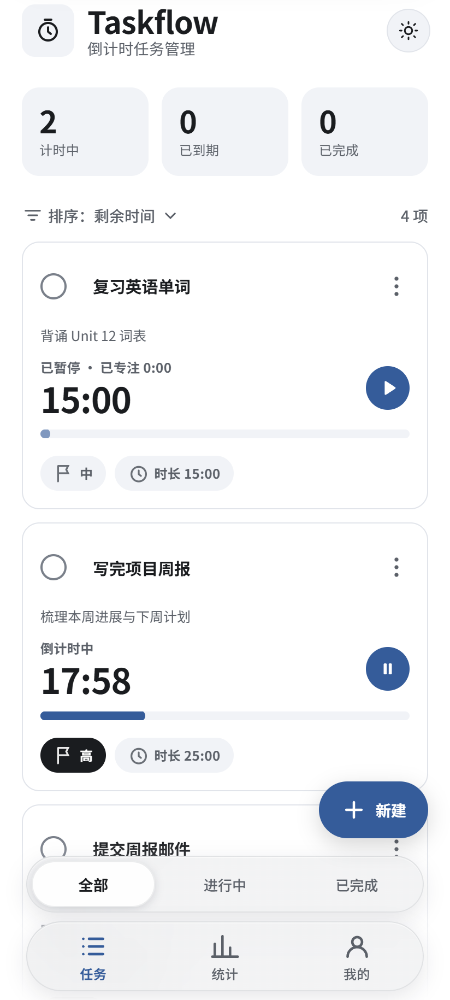
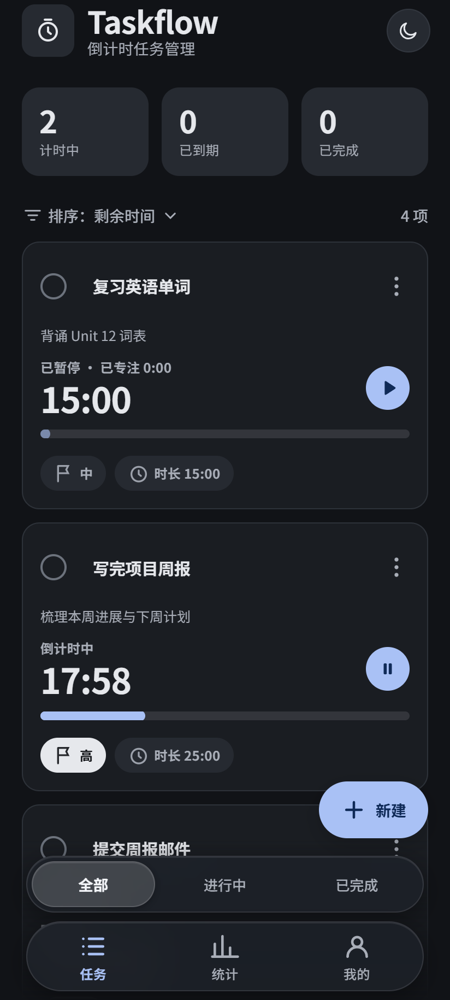

<div align="center">

# Taskflow · Countdown Task Manager

**A fully offline Android countdown task manager: a single-file web app plus a 1,013-line native shell.**
**Its signature is the theme-switch animation — a circular reveal expanding from the toggle, implemented twice (web and native).**

[](LICENSE)
[](https://developer.android.com/)


**English** · [简体中文](README.md)

  

[⬇️ Download APK](https://github.com/liuchenwei285/Taskflow/releases) · [Quick start](#quick-start) · [How it works](#-how-it-works)

</div>

---

## What it is

Taskflow is a **countdown task manager**: give a task a duration or a deadline, start it, and it counts down
in real time and reminds you when time is up. Every completed focus block is recorded and aggregated into
statistics.

| Feature | Detail |
|---|---|
| 🕐 Three timing modes | Fixed duration `duration` / deadline `deadline` / Pomodoro `pomodoro` |
| 🎚️ Sliding segmented filter | Drag the thumb between "All / Active / Done" with velocity projection and spring snapping |
| 🌗 Circular-reveal theme switch | See [The theme-switch animation](#-the-theme-switch-animation) |
| 🌐 Chinese / English UI | Switch in **Me → Language**; defaults to the system language, choice is remembered |
| 📊 Focus statistics | Daily aggregation; sessions crossing midnight are split across both days |
| 💾 Local storage | Everything lives in on-device `localStorage`; JSON backup import / export |
| 🔕 Due reminders | Native notification channel (Android) + standard Notification API (browser) |
| 🪶 Offline | **No network permission requested**; no network calls anywhere in the build |
| 🧱 Build-free front end | The entire UI is **one 4,178-line HTML file** — no framework, no bundler, no CDN |

---

## ✨ The theme-switch animation

This is the part that received the most attention: **the colour swap happens in a single frame at the start of
the transition, and the animation does nothing but reveal the new theme.**


<p align="center">
  
</p>
<p align="center"><sub>Recorded on a headless Chromium at 412×915 · <a href="docs/theme-switch.webm">download the webm</a></sub></p>

### Design principle: reveal, don't cross-fade

Most theme switches cross-fade the old screen out and the new one in. A cross-fade leaves the entire screen
in a semi-transparent overlap for its whole duration — on an interface with frosted glass
(`backdrop-filter`) that overlap smears into a single blurred mess.

Taskflow splits the transition into two separate things:

1. **Swap colours in one frame** — the old layer is frozen into a static snapshot, the new layer is already
   the final render.
2. **Clip only the new layer to a circle** — `clip-path: circle(0 → R)`, centred on the theme toggle, so the
   circle pushes the old theme outwards.

The result: the area inside the circle is always the finished render. Nothing re-colours after the reveal,
nothing flashes, no translucent ghosting.

### Web implementation: View Transitions API

```js
// Centre = the toggle's centre in viewport coordinates;
// radius = distance to the farthest corner (recomputed each time, never cached)
const R = Math.hypot(Math.max(cx, vw - cx), Math.max(cy, vh - cy)) + 2;

// Write the centre before the transition mounts, so the new layer is
// already clipped on its very first frame and never flashes full-screen
root.style.setProperty('--vt-cx', cx + 'px');
root.style.setProperty('--vt-cy', cy + 'px');

const vt = document.startViewTransition(function(){
  root.classList.add('theme-switching');   // freeze every transition/animation
  paintTheme(next);                        // swap colours once
});

vt.ready.then(function(){
  root.animate(
    { clipPath: ['circle(0px at ' + cx + 'px ' + cy + 'px)',
                 'circle(' + R + 'px at ' + cx + 'px ' + cy + 'px)'] },
    { duration: 500,
      easing: 'cubic-bezier(0.32, 0.72, 0, 1)',
      fill: 'both',
      pseudoElement: '::view-transition-new(root)' });
});
```

Matching CSS turns the default cross-fade off entirely and keeps only the clip:

```css
::view-transition-group(root){ animation:none }
::view-transition-old(root){ z-index:1; animation:none; mix-blend-mode:normal }
::view-transition-new(root){ z-index:2; animation:none; mix-blend-mode:normal;
  clip-path:circle(0px at var(--vt-cx, 50%) var(--vt-cy, 50%)) }
```

### Why the frosted glass must be flattened during the transition

Both bottom pills use `backdrop-filter: blur(20px) saturate(160%)`. During the transition two snapshot layers
coexist, and the glass samples **the layer underneath it** — so a smeared, colour-polluted blob shows up on
the new layer.

The fix is to swap to a solid colour for the duration and let CSS restore the glass afterwards:

```css
html.theme-switching .pill{
  -webkit-backdrop-filter:none!important;
  backdrop-filter:none!important;
  background:var(--pill-solid)!important;
  background-image:none!important;
  box-shadow:none!important;
}
html.theme-switching .seg__ind{
  backdrop-filter:none!important; background:var(--thumb-solid)!important;
}
```

The same `html.theme-switching` class also disables every `transition` / `animation` (pseudo-elements
included), guaranteeing that the area inside the circle is a static final frame.

### Native implementation: snapshot overlay with an inverted hole

Inside the APK, View Transitions behaviour depends on the WebView version, so the native side carries an
equivalent implementation using the same easing and the same 500 ms duration:

```java
captureWindow(new Runnable() {          // 1. capture the current window
    @Override public void run() {
        showOverlayAndAnimate(cxFrac, cyFrac, dark);
    }
});

// RevealOverlayView draws the snapshot and punches an even-odd path hole over decorView
overlay.setSnapshot(snapshot);
((ViewGroup) decor).addView(overlay, MATCH_PARENT, MATCH_PARENT);

// 2. apply the theme underneath the overlay in one shot (no Activity recreation, no layout pass)
applyThemeInstant(dark);

// 3. start the animation on the next frame, once the new theme has painted
ValueAnimator.ofFloat(0f, maxR)                       // maxR = farthest corner + 8dp
    .setInterpolator(new PathInterpolator(0.32f, 0.72f, 0f, 1f))
```

The hole expands from **the toggle's centre**, matching the web version visually.

### Fallback chain

If any link in the chain is unavailable, the app falls back to an instant switch. It never stops halfway:

| Condition | Behaviour |
|---|---|
| System animations disabled (`animator_duration_scale = 0`) | Native `applyThemeInstant`; web branch checks `animScale === 0` |
| View Transitions unsupported | Instant switch |
| `prefers-reduced-motion: reduce` | Instant switch |
| Native snapshot capture failed | Instant switch, no leftover ghost |
| Transition interrupted (`cancel`) | Idempotent `endThemeSwitch()` cleanup |

### Where the theme comes from

- **Follow the system**: reacts to `prefers-color-scheme` changes (default).
- **Material You** (Android 12+): wallpaper-derived colours are pushed from the native side via
  `getThemeTokens()` and applied on the web side through `window.__onThemeTokens(payload)`.
- **No first-paint flash**: an inline script in `<head>` resolves `data-theme` from
  `prefers-color-scheme` before the stylesheet is parsed.

---

## 🌐 Interface language (中文 / English)


- **Entry point**: a two-segment control under **Me → Language**. The change applies immediately, is written to
  `prefs.lang`, and is reused on the next launch.
- **Follows the system by default**: if the first entry of `navigator.languages` starts with `zh`, the UI is
  Chinese; otherwise English. Either can be locked manually.
- **How it works**: static copy is switched by walking DOM text nodes and caching the Chinese original
  (gettext-style `msgid`); dynamically rendered copy goes through `T()` / `Tn()`. The dictionary has 212 entries
  and falls back to Chinese when a translation is missing, so nothing ever renders blank.
- **Localised formatting**: countdown units (`3d 04:05:06` vs `3天`), relative time (`in 5m` vs `5分钟后`),
  absolute time (`Nov 16 09:30` vs `11月16日 09:30`) and counts (`4 items` vs `4 项`) all follow the active language.
- **Zero-residue guarantee**: `e2e-i18n.js` scans the visible text plus `aria-label` / `placeholder` / `title`
  in English mode and fails on any Chinese character (the 「中文」 button label itself is exempt).

---

## 🧭 How it works

### Three layers

```
┌─ android/ ────────────────────────────────────────────────┐
│  MainActivity.java   (745)  WebView shell + theme reveal    │
│  Notifications.java  (88)   native notification channel     │
│  RevealOverlayView   (80)   snapshot overlay, inverted hole │
│  Exporter.java       (100)  backup export via SAF           │
│  assets/index.html          synced from the repository root │
└────────────────────────────────────────────────────────────┘
┌─ web ─────────────────────────────────────────────────────┐
│  task-timer-app.html (4178)  single file: all UI + logic    │
│  · theme / tokens / animation   · tasks / timing / pomodoro │
│  · segmented control + spring   · stats aggregation         │
│  · localStorage persistence     · frame-time sampling       │
└────────────────────────────────────────────────────────────┘
```

The native shell does only four things: **load local assets, expose `AndroidBridge`, play the theme
animation, post notifications**. Everything else lives in the web layer, so virtually every UI issue is
debuggable with browser DevTools alone.

### Startup sequence

```
MainActivity.onCreate
  └─ new WebView → setJavaScriptEnabled / setDomStorageEnabled
     └─ addJavascriptInterface(new Bridge(), "AndroidBridge")
        └─ loadUrl("file:///android_asset/index.html")
           └─ inline <head> script: resolve data-theme (no first-paint flash)
              └─ read localStorage → hydrate tasks → first render → start the 250ms heartbeat
```

### Countdown model: timestamps, not accumulation

The countdown **never accumulates via `setInterval`** — accumulation drifts whenever the screen sleeps, the
app is backgrounded, or the process is killed. Instead it stores the start instant:

```js
function remainingOf(t){
  if (t.status === 'running' && t.startedAt){
    const base = (t._baseRemaining != null) ? t._baseRemaining : t.remainingMs;
    return base - (now() - t.startedAt);   // recomputed from wall-clock time every time
  }
  return t.remainingMs != null ? t.remainingMs : t.durationMs;
}
```

- **Pause**: freeze the current remainder into `remainingMs` and clear `startedAt`.
- **Process death / page reload**: `startedAt` is persisted, so the remainder picks up where it left off.
- **Pomodoro**: `phaseAt(t, now)` determines the current phase, its progress and its remainder.
- **Deadline mode**: pure `dueAt - now`, no accumulation.
- UI heartbeat every 250 ms; persistence is throttled (once per 20 s while a task is running).

### Focus sessions and statistics

Each completed focus block becomes one session:

```js
sessions.push({
  id, taskId, taskTitle, kind: 'focus'|'short'|'long',
  startAt, endAt, ms, dateKey: 'YYYY-MM-DD'
});
```

`pushSessions()` splits any block that **crosses midnight** into two records, one per day (with an iteration
cap so it can never loop forever). Without this, one late-night session would corrupt both "today" and
"last 7 days". The statistics page then aggregates by `dateKey` into the bar chart, completion rate and
priority breakdown.

### Storage and backups

```js
const STORAGE_KEY = 'taskflow.tasks.v1';   // tasks + sessions
const PREFS_KEY   = 'taskflow.prefs.v1';   // sort / group / view / theme
const BACKUP_KEY  = 'taskflow.backup.v1';  // automatic snapshot
const SCHEMA_VERSION = 2;
```

- Writes are preceded by a **snapshot pass** that strips runtime-only fields (`_baseRemaining` etc.), so the
  on-disk payload stays readable and migratable.
- Reads are validated against `SCHEMA_VERSION`; a backup from a newer schema fails loudly instead of being
  silently truncated.
- Export produces `taskflow-backup-YYYYMMDD-HHMM.json`; inside the APK it goes through
  `AndroidBridge.saveFile()` (SAF), in a browser it degrades to a Blob download.
- Import validates `app === 'taskflow'`, `schemaVersion` and per-task field integrity before merging.
- A `storage` listener replaces in-memory state when another tab or an external tool modifies the data.

### Notifications

A WebView offers no `Notification` API, so the app goes through the native bridge:

```
web sendSystemNotification()
  └─ AndroidBridge.requestNotificationPermission()   // POST_NOTIFICATIONS
     └─ Notifications.show() → NotificationChannel("taskflow_due", IMPORTANCE_HIGH)
        └─ setSmallIcon(R.mipmap.ic_launcher) + BigTextStyle + vibration waveform
```

In a browser preview the same code degrades to the standard `Notification` API with identical permission
handling.

### The bottom dock and the sliding segmented control

The two bottom pills (segmented filter + tab bar) are fixed frosted glass:

```css
.pill{
  position:fixed; left:var(--dock-inset); right:var(--dock-inset); z-index:45;
  background:var(--lg-underlay), var(--lg-tint);
  border:1px solid var(--lg-border);
  backdrop-filter:blur(20px) saturate(160%);
  box-shadow:inset 0 1px 0 var(--lg-inner), var(--lg-shadow);
}
```

Several non-obvious pitfalls are handled in code:

- **Content must not sit under the pills**: `.app-shell` is its own scroll container whose bottom edge
  fades out through a `mask-image` gradient, and `padding-bottom = pill height + gap + safe-area + 24px`,
  so the last row stays fully visible and tappable.
- **The dock is inset 4dp relative to content**: 24dp vs the cards' 20dp, preserving the same 4dp delta on
  narrow screens (≤360dp).
- **Touch dragging**: `pointerdown` calls `setPointerCapture` immediately, events are delegated to the
  **track** rather than the thumb, `touch-action: pan-y` applies to both, and
  `pointerup / cancel / lostpointercapture` share one teardown path. (Touch browsers apply implicit pointer
  capture on the pressed `button`; without this layer the drag "lets go" halfway through.)
- **Snapping**: the drag carries velocity projection, the thumb snaps to a legal segment on release, and the
  filter is **only committed after the snap** — so results never flicker mid-drag.
- **Visibility guarantee**: an idle watchdog checks thumb size and opacity and resets it if anything looks
  wrong — the fix for the earlier "thumb disappears after dragging" bug.

### Performance guard and automatic downgrade

Frame times are sampled with `requestAnimationFrame` during drags and scrolls, and the app steps down when
they exceed budget:

| Tier | Behaviour |
|---|---|
| Normal | `blur(20px) saturate(160%)` frosted glass |
| `perf-lite` | blur reduced to `blur(12px) saturate(120%)` |
| `no-glass` | solid panels (`#F1F3F7` / `#262A31`), `backdrop-filter` fully off |

Downgrades also respect user preferences: `prefers-reduced-transparency: reduce`, system animations off, and
the Firefox / WebKit compatibility paths all land on solid colours. Measured on drag and scroll: p50 ≈ 5.6 ms,
p95 ≈ 5.7 ms, `>8ms` share 0% — no downgrade triggered.

> The `lg*` prefix in the code is a leftover from the earlier liquid-glass (refraction) design. It now stands
> for "liquid glass" as a name only: the refraction engine, SVG displacement filters, displacement maps,
> `ResizeObserver` rebuilds and filter lifecycle management were all removed when the material reverted to
> frosted glass.

---

## Quick start

### Browser preview

```bash
git clone https://github.com/liuchenwei285/Taskflow.git
cd Taskflow
npx serve .          # or any static server
# open http://localhost:3000/task-timer-app.html
```

> Opening the file over `file://` mostly works too, but some browsers restrict `localStorage` there — an
> http origin is recommended.

### Install the APK

Download `taskflow-v2.6.1.apk` from [Releases](https://github.com/liuchenwei285/Taskflow/releases) and
install on Android 7.0 (API 24) or newer.

---

## Building the APK

There is **no Gradle**. A single script runs `aapt2 → javac → d8 → zipalign → apksigner`:

```bash
cd android
# requires Android SDK build-tools 34.0.0 and JDK 17 (paths are set in the script)
bash build-apk.sh
# output: dist/taskflow-v2.6.1.apk
```

Notes:

- **The signing key is not in the repository** (`android/keystore/` is git-ignored). The script generates a
  throwaway debug keystore on first run; replace it for real releases.
- `android/app/src/main/assets/index.html` is the copy shipped inside the APK. After editing the root
  `task-timer-app.html`, sync it over — the two must stay byte-identical.
- Icons are generated from SVG into 5 densities by `android/icon-source/generate-icons.js`;
  `verify-apk-icons.js` then validates the packaged resources pixel by pixel.

---

## Tests

```bash
npm install                 # playwright (devDependency)
npx playwright install chromium
npm test                    # starts a static server and runs all three suites
```

`npm test` binds a static server on `127.0.0.1:8899` (or reuses an existing one) and then runs the suites in
order. You can also run them individually:

```bash
node tools/serve.js &        # start the server manually
node test-taskflow.js        # pure logic
node e2e-taskflow.js         # browser E2E
node e2e-notify.js           # notifications
```

| Suite | Size | Coverage |
|---|---|---|
| `test-taskflow.js` | 103 assertions | Pure logic: timing, Pomodoro phases, sort/group, storage, backup validation |
| `e2e-taskflow.js` | 157 assertions | Browser E2E: full task flow, filters, drag-snap, theme switch, import/export |
| `e2e-notify.js` | 18 assertions | Notifications and permissions: permission branches, reminder firing, vibration |
| `e2e-i18n.js` | 23 assertions | Language: system default, manual switch, persistence, zero Chinese residue in English mode, no overflow at 360px |

All suites run in headless Chromium; `e2e-taskflow.js` additionally covers the Firefox and WebKit fallback
paths.

---

## Project layout

```
Taskflow/
├─ task-timer-app.html      # single-file web app (4178 lines: all UI + logic)
├─ test-taskflow.js         # logic regression
├─ e2e-taskflow.js          # browser E2E
├─ e2e-notify.js            # notification regression
├─ e2e-i18n.js              # language (Chinese / English) acceptance
├─ package.json
├─ android/
│  ├─ app/src/main/
│  │  ├─ java/com/taskflow/app/   # native shell (MainActivity / Notifications / RevealOverlayView / Exporter)
│  │  ├─ res/                     # themes, colours, 5-density icons
│  │  └─ assets/index.html        # synced with the root task-timer-app.html
│  ├─ build-apk.sh            # Gradle-free build + signing
│  ├─ inject_apk.py
│  └─ icon-source/            # icon SVG, generation and verification scripts
├─ docs/                     # README assets (screenshots, animation breakdown, recording)
├─ tools/                    # static server, one-command test runner, doc capture
└─ .gitignore
```

---

## Design decisions & known limitations

- **Why no web framework**: the whole app is one HTML file you can open by double-clicking. No build step —
  edit a line, refresh, done. For a single-device tool like this, the framework's overhead outweighs its
  benefits.
- **Why liquid glass (refraction) was abandoned**: refraction required SVG displacement filters, displacement
  maps and `ResizeObserver` rebuilds, which measurably dropped frames on mid-range devices, and the edge
  dispersion hurt text legibility. It was reverted to stable frosting at
  `blur(20px) saturate(160%)`, which measures better (filters 4 → 0, DOM nodes 417 → 315).
- **The notification small icon reuses the colour launcher icon**: Android renders small icons as a
  monochrome silhouette, so the status bar only shows the shape. Fixing this needs a dedicated
  `ic_stat_notify` asset.
- **No adaptive icon**: adding `mipmap-anydpi-v26` would make `R.mipmap.ic_launcher` resolve to an
  `AdaptiveIconDrawable` on API 26+, which `setSmallIcon()` rejects — a notification regression.
- **White icon background** has a weak edge against a pure-white wallpaper. Adding a light outline to the
  source SVG and regenerating is enough if you want more definition.

---

## Contributing

Issues and PRs are welcome. Please label issues so they can be triaged:

| Label | Purpose |
|---|---|
| `bug` | Behaviour that contradicts expectations |
| `ui` / `animation` / `glassmorphism` | Layout / motion and transitions / frosted-glass material |
| `performance` | Frame time, memory, startup |
| `android` / `web` | Affects only the Android shell / only the web side |
| `enhancement` | Feature request |
| `refactor` | Internal change with no external behaviour change |
| `documentation` | README, comments or examples |
| `accessibility` | A11y and keyboard operation |
| `question` | Usage questions and discussion |

`good first issue` and `help wanted` mark tasks suitable for newcomers.

---

## License

[MIT](LICENSE) © Alfred Liu

The icon is generated from [taskflow-icon-B-pink-hot.svg](android/icon-source/taskflow-icon-B-pink-hot.svg).
Code snippets above are lightly simplified for readability; the source itself is commented in Chinese.
