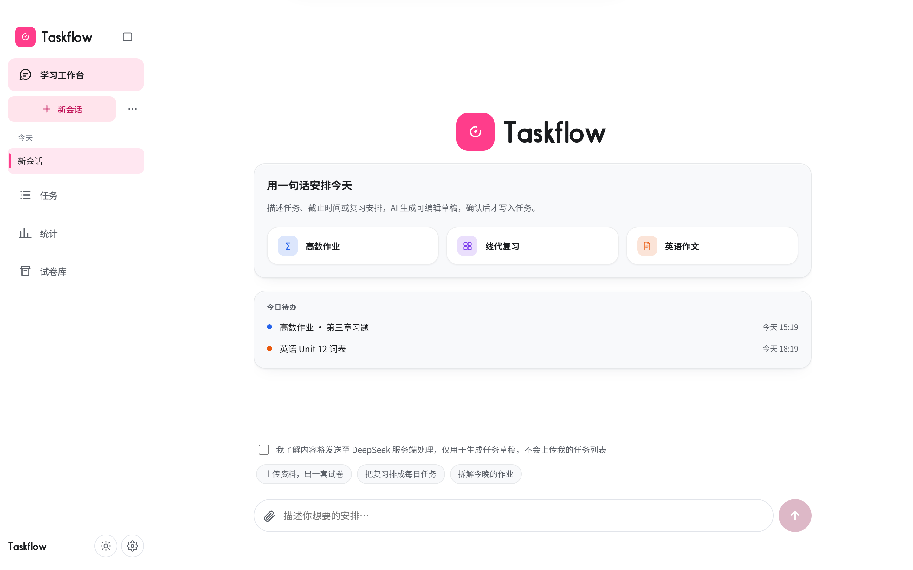
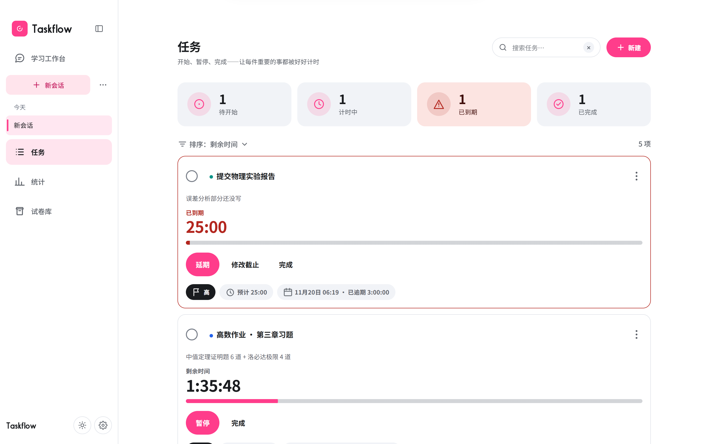
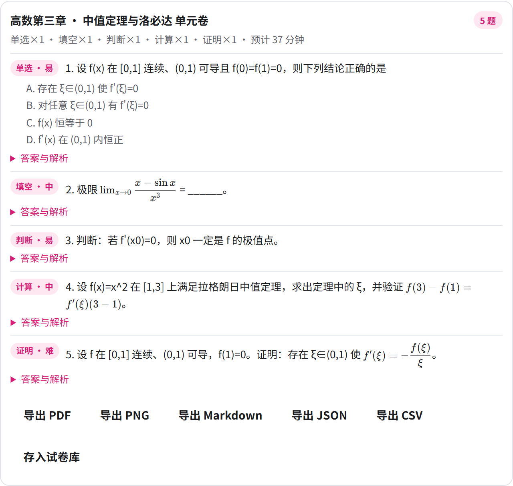
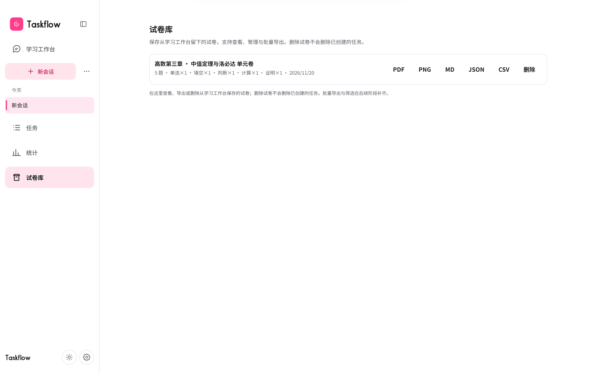
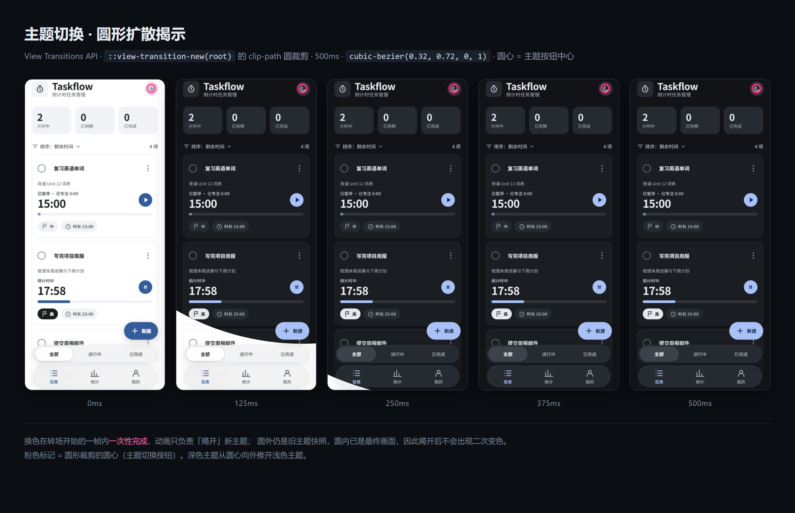
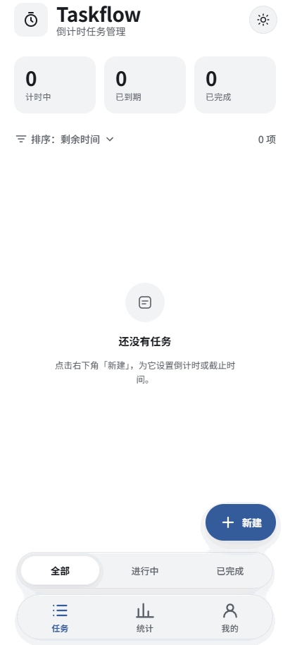

<div align="center">

# Taskflow · 把一份笔记，变成一套会计时的试卷和每日任务

**一个"资料 → 试卷 → 计时任务"的学习工作台。**
**同一份单文件应用，跑在浏览器、Windows 独立 exe 和 Android WebView 壳里，三份逐字节一致。**

[](LICENSE)
[](https://github.com/liuchenwei285/Taskflow/releases)
[](task-timer-app.html)
[](#-不配-ai-也能用)

[English](README.en.md) · **简体中文**

 

[⬇️ Windows 独立 exe](https://github.com/liuchenwei285/Taskflow/releases/tag/v2.6.1-windows) · [⬇️ Android APK](https://github.com/liuchenwei285/Taskflow/releases) · [🌐 在线体验](https://taskflow-app-3qo4c3iuyvd.qoder.zone/) · [使用说明](#快速开始)

</div>

---

## 这是什么

大多数计时 App 管理的是"时间"，但学生缺的往往不是时间，而是"这段时间到底做什么"。Taskflow 把这件事接成一个闭环：

> 上传笔记 → 本地解析 → AI 出题 → 估算用时 → 确认创建任务 → 开始倒计时 → 导出试卷 → 存入试卷库

整条链路在同一个对话框里完成，不跳页、不填表。试卷不是终点：它带着"预计 37 分钟"的估时，变成任务页里一条真正能开始、暂停、完成的倒计时任务。**出题和执行，在一个闭环里。**

| 形态 | 入口 | 说明 |
|---|---|---|
| 🌐 在线 | [Qoder Sites](https://taskflow-app-3qo4c3iuyvd.qoder.zone/) | 免登录、免安装，手机电脑都能开 |
| 🪟 Windows | [v2.6.1-windows Release](https://github.com/liuchenwei285/Taskflow/releases/tag/v2.6.1-windows) | 单文件 exe，双击即用，HTML 与图标内嵌，无附属文件夹 |
| 🤖 Android | [Releases](https://github.com/liuchenwei285/Taskflow/releases) | WebView 壳 + 原生通知与主题动画，minSdk 24 |
| 📄 浏览器本地 | 双击 `task-timer-app.html` | 零依赖单文件，断网可用 |

---

## 学习工作台：资料 → 试卷 → 任务

这是这一版的核心。在首屏输入框里说一句话，AI 把笔记变成可执行的安排：

- **出一套卷**：传一份 `.txt` / `.md` 笔记，说"用这份笔记出一套 5 道题的单元卷"。返回单选 / 填空 / 判断 / 计算 / 证明混排的试卷卡，KaTeX 公式实时渲染，逐题估时。
- **拆解任务**：说"拆解今晚的作业"，AI 生成**可编辑草稿**，你点确认才写入任务——**确认前不发任何写入请求**。
- **本地解析**：上传、SHA-256 内容指纹去重、分节与预览都在浏览器内完成，只有"出题"一步需要 AI。



做完的试卷进试卷库，支持 **PDF / PNG / Markdown / JSON / CSV 五种真实导出**，均不依赖 AI；删除试卷不会删除由它创建的任务。



### AI 是加速器，不是发动机

**不配置任何模型接口，以下全部是真实可用的功能，不是演示占位：**

- 手动创建与全生命周期：优先级、任务 / 番茄钟双模式、预计时长与截止时间可同时设置；待开始 / 计时中 / 已暂停 / 已完成 / 已到期五状态本地迁移，暂停不计入用时、刷新不丢进度。
- 提醒与提前预警：逐任务提前预警（1 / 5 / 10 分钟）、到期提示音 + 系统通知，关闭权限后仍弹页面内提醒；已到期可延期或改截止。
- 组织与回顾：搜索（含中文输入法组合路径）、排序、分组、状态筛选；统计页周柱状图与全年热力图由真实专注记录汇总。
- 数据与体验底面：备份一键导出 / 导入（导入前自动先备份一次）；深浅主题、自定义强调色、中英双语、减少动效、320px 窄屏。

要用 AI 出卷 / 规划，在「设置 → AI 服务」填你自己的模型接口（兼容 OpenAI / Anthropic 协议）；密钥只存在浏览器本地、请求从浏览器直发你配置的接口，**不上传任务列表、不放前端服务器**。接口出错给九类可操作文案 + 短错误码 + 限次重试，不白屏。

---

## 两种倒计时，一套状态机

这一版把最容易混淆的语义彻底拆开：

- **预计时长**：你按下开始后才走的工作计时，暂停就冻结。
- **截止时间**：自然时间，到点就到期，与你是否开始无关。

任务卡片走五状态：待开始 → 计时中 ⇄ 已暂停 → 已完成 / 已到期。规则写进测试断言：暂停不计入用时、刷新不丢进度、到期自动暂停并保留已用时间、已完成不再判到期。


计时**存时间戳、不存累加值**——息屏、后台、杀进程后都按真实时间重算，不会漂移：

```js
function remainingOf(t){
  if (t.status === 'running' && t.startedAt){
    const base = (t._baseRemaining != null) ? t._baseRemaining : t.remainingMs;
    return base - (now() - t.startedAt);   // 每次按真实时间重算
  }
  return t.remainingMs != null ? t.remainingMs : t.durationMs;
}
```

---

## ✨ UI 主题切换动画

换色在转场开始的一帧内一次性完成，动画只负责"揭开"新主题——这是本项目最花心思的地方。



<p align="center">
  
</p>

**揭开，而不是淡化**：绝大多数主题切换用"旧画面淡出 + 新画面淡入"，但在有磨砂玻璃（`backdrop-filter`）的界面上会糊成一片。Taskflow 把转场拆成两件事：一帧内换色（旧层定格快照、新层已是最终画面），只对新层做 `clip-path: circle(0 → R)` 裁剪，圆心是主题按钮。圆内永远是已完成的最终画面，不会二次变色或闪半透明重影。

```js
const R = Math.hypot(Math.max(cx, vw - cx), Math.max(cy, vh - cy)) + 2;
root.style.setProperty('--vt-cx', cx + 'px');
root.style.setProperty('--vt-cy', cy + 'px');
const vt = document.startViewTransition(function(){
  root.classList.add('theme-switching');   // 冻结所有过渡/动画
  paintTheme(next);                        // 一次性换色
});
vt.ready.then(function(){
  root.animate(
    { clipPath: ['circle(0px at ' + cx + 'px ' + cy + 'px)',
                 'circle(' + R + 'px at ' + cx + 'px ' + cy + 'px)'] },
    { duration: 500, easing: 'cubic-bezier(0.32, 0.72, 0, 1)', fill: 'both',
      pseudoElement: '::view-transition-new(root)' });
});
```

转场期间把毛玻璃临时拍平（`html.theme-switching .pill { backdrop-filter:none }`），避免新层采样到旧层快照。降级链完整：系统关动画、浏览器不支持 View Transitions、`prefers-reduced-motion`、原生截图失败、转场被中断，都回落到"直接切换、不播动画"。

Android 壳里另有一套等价实现：截当前窗口 → 快照遮罩反向挖洞 → 遮罩下一次切主题 → `ValueAnimator` 从按钮圆心扩张，共用同一组缓动参数与 500ms 时长。

---

## 🌐 界面语言与主题

- **中英双语**：582 条词条同步；「我的 → Language」切换立即生效并本地记忆，默认跟随系统语言。英文模式有 E2E 扫描零中文残留。
- **深浅 + 自定义强调色**：两套主题共用同一布局与动效，强调色一改全跟随；首屏 `<head>` 内联脚本在样式解析前定好 `data-theme`，不闪白。
- **Material You**（Android 12+）：原生从壁纸取色下发调色板，网页侧 `window.__onThemeTokens()` 接收后刷新 CSS 变量。


---

## 🧭 架构：一份代码，三种形态

```
┌─ task-timer-app.html (10395 行) ──────────────────────────┐
│  单文件：全部 UI + 全部逻辑，零框架 / 零打包 / 零 CDN        │
│  · 学习工作台：上传解析 / SHA-256 去重 / AI 对话 / 试卷卡     │
│  · 任务引擎：五状态机 / 时间戳计时 / 番茄钟 / 提前预警         │
│  · 试卷库：PDF·PNG·MD·JSON·CSV 导出                         │
│  · 主题 / 动效 / 令牌  · 统计聚合  · 备份导入导出             │
│  · localStorage 持久化 · 582 条中英词条                      │
└──────────────────────────────────────────────────────────────┘
   ↑ 逐字节同步               ↑ 内嵌为资源               ↑ 内嵌为资源
┌──────────────┐  ┌──────────────────────┐  ┌────────────────────┐
│ web / Sites  │  │ windows/  WinForms   │  │ android/ WebView   │
│ 静态托管      │  │ + WebView2 单文件壳   │  │ 原生通知 / 主题动画 │
└──────────────┘  └──────────────────────┘  └────────────────────┘
```

- **Windows**：`windows/` 下是 WinForms + WebView2 壳。HTML 与圆角图标作为 `EmbeddedResource` 编进 `Taskflow.exe`，启动时释放到 `%LOCALAPPDATA%\Taskflow\app\`，用 `taskflow.app` 虚拟主机映射加载——所以 exe 可单独拷走、无附属文件，localStorage 有稳定 origin。
- **Android**：原生壳只做四件事——加载本地资源、提供 `AndroidBridge`、播主题动画、发通知。其余全在网页层，UI 问题能用浏览器 DevTools 直接调试。
- **三份 HTML**（根目录 / `site/` / `android/app/src/main/assets/` / `windows/app/`）md5 校验锁死一致。

### 专注记录与统计

每次专注结束写入一条 `{taskId, kind, startAt, endAt, ms, dateKey}`；跨午夜的专注段按午夜切成两段分别归属两天，统计页再按 `dateKey` 聚合出周柱状、完成率、优先级分布与全年热力图。

### 存储与备份

任务 / 会话 / 偏好分键存 `localStorage`，写前做快照式清理（去掉 `_baseRemaining` 等运行时字段），读时按 `SCHEMA_VERSION` 校验。导出为 `taskflow-backup-YYYYMMDD-HHMM.json`，APK 内走 SAF、浏览器走 Blob 下载；导入前校验结构并自动先备份当前数据一次。

---

## 快速开始

### Windows 独立应用（最省事）

从 [v2.6.1-windows Release](https://github.com/liuchenwei285/Taskflow/releases/tag/v2.6.1-windows) 下载 `Taskflow-Windows-v2.6.1.zip`，解压后**双击 `Taskflow.exe`**。需要 Windows 10/11（自带 Edge 即有 WebView2 Runtime，缺失会弹提示）。不配 AI 密钥即可用全部本地功能。

### 在线 / 浏览器

打开 [在线体验](https://taskflow-app-3qo4c3iuyvd.qoder.zone/)，或本地起服务：

```bash
git clone https://github.com/liuchenwei285/Taskflow.git
cd Taskflow
npx serve .
# 打开 http://localhost:3000/task-timer-app.html
```

> 双击 `file://` 也能用，但部分浏览器限制 `localStorage`，建议 http 协议。

### Android

从 [Releases](https://github.com/liuchenwei285/Taskflow/releases) 下载 APK，装到 Android 7.0（API 24）+。

---

## 构建

### Windows exe

需要 .NET 8 SDK + Windows Desktop Runtime；WebView2 NuGet 包由 `dotnet restore` 拉取：

```bash
cd windows
python make-rounded-icon.py        # 可选：重生成圆角图标源
python make-ico.py                 # 可选：生成多尺寸 ico
dotnet publish -c Release -r win-x64 --self-contained true \
  -p:PublishSingleFile=true -p:EnableCompressionInSingleFile=true \
  -p:IncludeNativeLibrariesForSelfExtract=true -p:DebugType=None \
  -o dist/Taskflow-Windows
# 产物：dist/Taskflow-Windows/Taskflow.exe（单文件，约 64MB）
```

改完根目录 `task-timer-app.html` 后，先同步到 `windows/app/taskflow.html` 再构建（两者需逐字节一致）。

### Android APK

不用 Gradle，一条脚本走完 `aapt2 → javac → d8 → zipalign → apksigner`：

```bash
cd android
bash build-apk.sh
# 产物：dist/taskflow-v2.6.1.apk
```

签名密钥不在仓库里（`android/keystore/` 已忽略），脚本首次运行自动生成调试用 keystore。

---

## 测试

```bash
npm install
npx playwright install chromium
npm test                    # 自动起静态服务器 + 跑完全部套件
```

也可单独跑：

```bash
node test-taskflow.js       # 纯逻辑
node e2e-taskflow.js        # 任务全流程
node e2e-study.js           # 学习工作台 / AI 出题
node e2e-conversation.js    # 多轮对话与上下文
node e2e-ai.js              # AI 状态机（成功/失败/重试/入库/渲染）
node e2e-welcome.js         # 欢迎弹窗 71 条断言：不碰用户任务数据
node e2e-motion.js          # 动效与自定义强调色红线
node e2e-i18n.js            # 中英双语零残留
```

共 12 套 Playwright E2E + 1 套逻辑回归，覆盖出题链路、五状态计时、通知双路径、宽窄屏、Firefox / WebKit 降级。Windows 壳另有 `windows/dev-verify.js`，通过 WebView2 CDP 在真实窗口跑 8 项验收（首启、建任务、倒计时走动、刷新持久化）。

---

## 项目结构

```
Taskflow/
├─ task-timer-app.html        # 单文件 Web 应用（10395 行）
├─ site/index.html            # Sites 静态托管副本（与根目录一致）
├─ functions/                 # 可选 AI 出题服务端代理
├─ vendor/                    # 内联 KaTeX / html2canvas（离线可用）
├─ i18n/en.json               # 582 条英词条
├─ e2e-*.js / test-taskflow.js# 12 套 E2E + 逻辑回归
├─ windows/                   # Windows 单文件壳（WebView2）
│  ├─ Program.cs / Taskflow.csproj / app.manifest
│  ├─ icon-source-rounded-512.png / make-rounded-icon.py / make-ico.py
│  ├─ app/taskflow.html       # 内嵌 HTML 源（与根目录一致）
│  └─ dev-verify.js           # 真实窗口 CDP 验收
├─ android/                   # Android WebView 壳 + 构建脚本 + 图标源
├─ submission/                # 比赛交卷帖与演示截图
├─ docs/                      # README 素材
└─ tools/                     # 静态服务器 / 一键测试 / 素材采集
```

---

## 设计取舍与已知限制

- **零 CDN、离线可用**：KaTeX 与 html2canvas 内联进单文件，教室弱网、内网、断网打开本地副本都照常渲染和导出。
- **为什么不把 exe 提交进仓库**：60MB+ 二进制会永久撑大 git 历史，所以构建产物全部忽略，发行物走 GitHub Releases。
- **AI 需自带密钥**：浏览器直连你配置的模型接口，密钥只存本地；内置转发通道在公网参赛环境未启用。不配 AI 时全部本地能力照常可用。
- **通知小图标复用彩色 launcher 图标**：Android 会渲染成单色剪影，状态栏只看得见形状；要修需单独做 `ic_stat_notify`。
- **Web 端主题动画依赖 View Transitions API**：不支持的浏览器 / WebView 直接切换、不播动画，不会卡在半途。
- **Windows 端**：导出走系统保存框、系统级通知在 WebView2 下未逐项实测；页面内提醒与计时链路已验证。

---

## 参与贡献

欢迎提 Issue 和 PR。提 Issue 时请顺手打标签：`bug` / `ui` / `animation` / `enhancement` / `web` / `android` / `documentation` 等。

---

## License

[MIT](LICENSE) © Alfred Liu

图标由 [taskflow-icon-B-pink-hot.svg](android/icon-source/taskflow-icon-B-pink-hot.svg) 生成；Windows 圆角版本由 `windows/make-rounded-icon.py` 从该设计派生。
