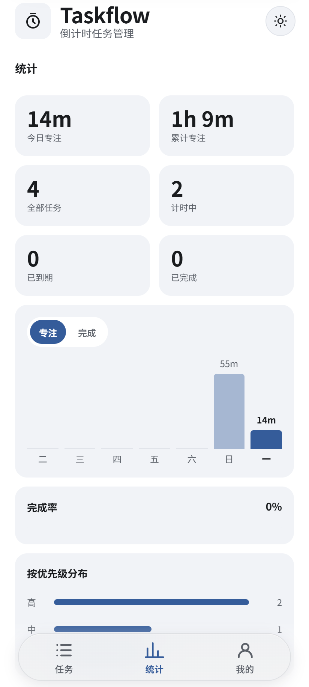
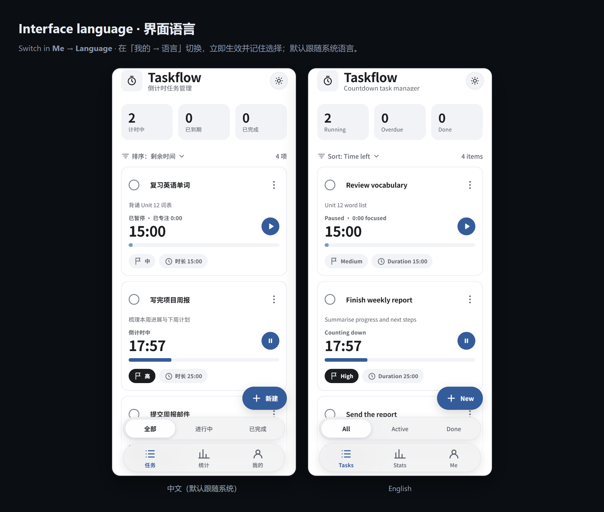

<div align="center">

# Taskflow · 倒计时任务管理

**一个完全离线的 Android 倒计时任务 App：单文件 Web 应用 + 1013 行原生壳。**
**招牌是主题切换动画——从按钮中心扩散的圆形揭示，深浅两套实现（Web / 原生）。**

[](LICENSE)
[](https://developer.android.com/)


[English](README.en.md) · **简体中文**

  

[⬇️ 下载 APK](https://github.com/liuchenwei285/Taskflow/releases) · [使用说明](#快速开始) · [工作原理](#-app-工作原理)

</div>

---

## 这是什么

Taskflow 是一个**倒计时任务管理**应用：给任务设置时长或截止时间，开始后实时倒计时，到点提醒，
并把每一段专注时长沉淀成可统计的记录。

| 特性 | 说明 |
|---|---|
| 🕐 三种计时模式 | 固定时长 `duration` / 截止时间 `deadline` / 番茄钟 `pomodoro` |
| 🎚️ 滑动分段筛选 | 底部滑块可在「全部 / 进行中 / 已完成」间拖动吸附，速度投影 + 弹簧回弹 |
| 🌗 圆形揭示主题切换 | 见下方 [主题切换动画](#-ui-主题切换动画) |
| 🌐 中英双语 | 「我的 → 语言」切换中文 / English，默认跟随系统语言，选择本地记忆 |
| 📊 专注统计 | 按天聚合专注时长，跨午夜的专注段会自动拆分到两天 |
| 💾 本地存储 | 全部数据在设备本地 `localStorage`，支持 JSON 备份导入 / 导出 |
| 🔕 到点提醒 | 原生通知通道（Android）+ 标准 Notification API（浏览器） |
| 🪶 离线 | **不申请网络权限**，安装包内没有任何网络调用 |
| 🧱 零构建前端 | 整个 UI 是**一个 4178 行的 HTML 文件**，无框架、无打包器、无 CDN |

---

## ✨ UI 主题切换动画

这是本项目最花心思的地方：**换色在转场开始的一帧内一次性完成，动画只负责「揭开」新主题。**


<p align="center">
  
</p>
<p align="center"><sub>实机录屏（无头 Chromium，412×915）· <a href="docs/theme-switch.webm">下载 webm 原片</a></sub></p>

### 设计原则：揭开，而不是淡化

绝大多数主题切换用「旧画面淡出 + 新画面淡入」。但淡入淡出会让整屏一直处于半透明的重叠状态，
在有磨砂玻璃（`backdrop-filter`）的界面上会直接糊成一片。

Taskflow 的做法是把转场拆成两件事：

1. **一帧内换色**——旧层被定格成静止快照，新层已经是换好色的最终画面；
2. **只对新层做圆形裁剪**——`clip-path: circle(0 → R)`，圆心是主题按钮，圆从按钮向外推开旧主题。

结果是：圆内永远是「已经完成的最终画面」，揭开后不会出现二次变色、不会闪烁、不会有半透明重影。

### Web 实现：View Transitions API

```js
// 圆心 = 按钮中心的视口坐标；半径 = 圆心到最远角的距离（每次现算，不缓存）
const R = Math.hypot(Math.max(cx, vw - cx), Math.max(cy, vh - cy)) + 2;

// 动画挂载前先写圆心：新层第一帧就被裁剪，不会闪全屏
root.style.setProperty('--vt-cx', cx + 'px');
root.style.setProperty('--vt-cy', cy + 'px');

const vt = document.startViewTransition(function(){
  root.classList.add('theme-switching');   // 冻结所有过渡/动画
  paintTheme(next);                        // 一次性换色
});

vt.ready.then(function(){
  root.animate(
    { clipPath: ['circle(0px at ' + cx + 'px ' + cy + 'px)',
                 'circle(' + R + 'px at ' + cx + 'px ' + cy + 'px)'] },
    { duration: 500,
      easing: 'cubic-bezier(0.32, 0.72, 0, 1)',
      fill: 'both',
      pseudoElement: '::view-transition-new(root)' });
});
```

配套的 CSS 把默认的交叉淡入彻底关掉，只保留裁剪：

```css
::view-transition-group(root){ animation:none }
::view-transition-old(root){ z-index:1; animation:none; mix-blend-mode:normal }
::view-transition-new(root){ z-index:2; animation:none; mix-blend-mode:normal;
  clip-path:circle(0px at var(--vt-cx, 50%) var(--vt-cy, 50%)) }
```

### 磨砂玻璃必须在转场期间「拍平」

底部两个胶囊用的是 `backdrop-filter: blur(20px) saturate(160%)`。转场时新旧两层快照同时存在，
毛玻璃会去采样**底下那一层**，于是新层上会出现一块被旧层污染的糊影。

解决办法是在转场期间临时换成纯色，结束后由 CSS 自动恢复：

```css
html.theme-switching .pill{
  -webkit-backdrop-filter:none!important;
  backdrop-filter:none!important;
  background:var(--pill-solid)!important;
  background-image:none!important;
  box-shadow:none!important;
}
html.theme-switching .seg__ind{
  backdrop-filter:none!important; background:var(--thumb-solid)!important;
}
```

同一个 `html.theme-switching` 类还顺手禁用了所有 `transition` / `animation`（含伪元素），
保证圆内画面是静止的最终态。

### 原生实现：快照遮罩 + 反向挖洞

在 APK 里 WebView 的 View Transition 表现受 WebView 版本影响，所以原生侧另有一套等价实现，
两者共用同一组缓动参数（`0.32, 0.72, 0, 1`）和同一套 500ms 时长：

```java
captureWindow(new Runnable() {          // 1. 截当前窗口
    @Override public void run() {
        showOverlayAndAnimate(cxFrac, cyFrac, dark);
    }
});

// RevealOverlayView 用 Path 的 even-odd 反向挖洞铺满 decorView
overlay.setSnapshot(snapshot);
((ViewGroup) decor).addView(overlay, MATCH_PARENT, MATCH_PARENT);

// 2. 遮罩之下一次性切主题（不重建 Activity、不触发布局变化）
applyThemeInstant(dark);

// 3. 下一帧再起动画，确保新主题已经完成一次绘制
ValueAnimator.ofFloat(0f, maxR)                       // maxR = 到最远角 + 8dp
    .setInterpolator(new PathInterpolator(0.32f, 0.72f, 0f, 1f))
```

遮罩挖洞从**按钮圆心**向外扩张，和 Web 版本观感一致。

### 降级链

任何一环不满足，都回落到「直接切换，不播动画」，绝不卡在半途：

| 条件 | 行为 |
|---|---|
| 系统动画被关（`animator_duration_scale = 0`） | 原生侧 `applyThemeInstant`；Web 侧 `animScale === 0` 直接切 |
| WebView / 浏览器不支持 View Transitions | 直接切 |
| `prefers-reduced-motion: reduce` | 直接切 |
| 原生截图失败 | 直接切，不留残影 |
| 转场被中断（`cancel`） | 幂等的 `endThemeSwitch()` 收尾 |

### 主题来源

- **跟随系统**：`prefers-color-scheme` 变化时自动跟随（默认）。
- **Material You**（Android 12+）：可从壁纸取色，原生通过 `getThemeTokens()` 下发调色板，
  网页侧 `window.__onThemeTokens(payload)` 接收后刷新 CSS 变量。
- **首屏不闪白**：`<head>` 里的内联脚本在样式表解析前就按 `prefers-color-scheme` 定好 `data-theme`。

---

## 🌐 界面语言（中文 / English）



- **入口**：「我的 → Language」两段控件，切换立即生效，写入 `prefs.lang` 并在下次启动沿用。
- **默认跟随系统**：`navigator.languages` 首个语言以 `zh` 开头 → 中文，其余 → English；也可手动锁定任一种。
- **实现**：静态文案用 DOM 文本节点遍历 + 中文原文缓存（gettext 风格 msgid），动态文案走 `T()` / `Tn()`，
  字典 212 条；缺失翻译自动回退中文，不会出现空白。
- **格式本地化**：倒计时单位（`3d 04:05:06` / `3天`）、相对时间（`in 5m` / `5分钟后`）、
  绝对时间（`Nov 16 09:30` / `11月16日 09:30`）、计数（`4 items` / `4 项`）都按语言输出。
- **零残留保证**：`e2e-i18n.js` 会在英文模式下扫描页面可见文本与 `aria-label` / `placeholder` / `title`，
  出现任何中文即判失败（语言按钮「中文」本身除外）。

---

## 🧭 App 工作原理

### 三层架构

```
┌─ android/ ────────────────────────────────────────────────┐
│  MainActivity.java (745)   WebView 壳 + 主题揭示 + 通知     │
│  Notifications.java (88)   原生通知通道                     │
│  RevealOverlayView (80)    快照遮罩反向挖洞                 │
│  Exporter.java (100)       备份文件导出（SAF）              │
│  assets/index.html  ← 与根目录 task-timer-app.html 同步     │
└────────────────────────────────────────────────────────────┘
┌─ web ─────────────────────────────────────────────────────┐
│  task-timer-app.html (4178)  单文件：全部 UI + 全部逻辑      │
│  · 主题 / 令牌 / 动画        · 任务 CRUD / 计时 / 番茄钟      │
│  · 滑动分段控件 + 弹簧吸附    · 统计聚合 / 备份导入导出         │
│  · localStorage 持久化       · 帧耗时采样与自动降档           │
└────────────────────────────────────────────────────────────┘
```

原生壳只做四件事：**加载本地资源、提供 `AndroidBridge`、播主题动画、发通知**。
其余全部在网页层，所以绝大多数 UI 问题都能用浏览器 DevTools 直接调试。

### 启动流程

```
MainActivity.onCreate
  └─ new WebView → setJavaScriptEnabled / setDomStorageEnabled
     └─ addJavascriptInterface(new Bridge(), "AndroidBridge")
        └─ loadUrl("file:///android_asset/index.html")
           └─ <head> 内联脚本：按 prefers-color-scheme 定 data-theme（防首屏闪白）
              └─ 读 localStorage → hydrate 任务 → 首次渲染 → 启动 250ms 心跳
```

### 计时模型：存时间戳，不存累加值

倒计时**不靠 `setInterval` 累加**（累加会在息屏、后台、被杀进程后漂移），而是存起始时刻：

```js
function remainingOf(t){
  if (t.status === 'running' && t.startedAt){
    const base = (t._baseRemaining != null) ? t._baseRemaining : t.remainingMs;
    return base - (now() - t.startedAt);   // 每次都按真实时间重算
  }
  return t.remainingMs != null ? t.remainingMs : t.durationMs;
}
```

- **暂停**：把当前剩余量冻结进 `remainingMs`，并清掉 `startedAt`。
- **杀进程 / 刷新页面**：重开时 `startedAt` 还在，剩余时间自动接上。
- **番茄钟**：`phaseAt(t, now)` 计算当前处于哪个阶段、该阶段进度与剩余。
- **截止时间模式**：只算 `dueAt - now`，不累计。
- UI 心跳 250ms 一次；落盘做了节流（有任务在跑时每 20s 存一次）。

### 专注记录与统计

每次专注结束写入一条 session：

```js
sessions.push({
  id, taskId, taskTitle, kind: 'focus'|'short'|'long',
  startAt, endAt, ms, dateKey: 'YYYY-MM-DD'
});
```

`pushSessions()` 会把**跨越午夜**的专注段按午夜切成两段分别归属两天（带循环上限防止死循环），
这样「今日专注」和「近 7 天」不会因为一次熬夜而算错。统计页再按 `dateKey` 聚合出柱状图、
完成率与优先级分布。

### 存储与备份

```js
const STORAGE_KEY = 'taskflow.tasks.v1';   // 任务 + 会话
const PREFS_KEY   = 'taskflow.prefs.v1';   // 排序 / 分组 / 视图 / 主题
const BACKUP_KEY  = 'taskflow.backup.v1';  // 自动快照
const SCHEMA_VERSION = 2;
```

- 写入前做**快照式清理**（去掉 `_baseRemaining` 等运行时字段），保证落盘数据可读、可迁移。
- 读取时按 `SCHEMA_VERSION` 校验，版本过高的备份会明确报错而不是静默丢弃。
- 导出：生成 `taskflow-backup-YYYYMMDD-HHMM.json`，APK 内走 `AndroidBridge.saveFile()`（SAF），
  浏览器内退化为 Blob 下载。
- 导入：校验 `app === 'taskflow'`、`schemaVersion`、任务字段完整性，通过后才合并。
- 还会监听 `storage` 事件，多标签页或外部修改时用外部数据替换内存状态。

### 通知

APK 的 WebView 不提供 `Notification` API，所以走原生桥：

```
网页 sendSystemNotification()
  └─ AndroidBridge.requestNotificationPermission()   // POST_NOTIFICATIONS
     └─ Notifications.show() → NotificationChannel("taskflow_due", IMPORTANCE_HIGH)
        └─ setSmallIcon(R.mipmap.ic_launcher) + BigTextStyle + 震动波形
```

浏览器预览环境则退化为标准 `Notification` API，权限请求与提醒逻辑一致。

### 底部 dock 与滑动分段控件

底部两个胶囊（分段筛选控件 + Tab 栏）是 fixed 的磨砂玻璃：

```css
.pill{
  position:fixed; left:var(--dock-inset); right:var(--dock-inset); z-index:45;
  background:var(--lg-underlay), var(--lg-tint);
  border:1px solid var(--lg-border);
  backdrop-filter:blur(20px) saturate(160%);
  box-shadow:inset 0 1px 0 var(--lg-inner), var(--lg-shadow);
}
```

几个容易踩坑的地方，代码里都处理了：

- **内容不能被胶囊压住**：`.app-shell` 是独立的滚动容器，底部用 `mask-image` 线性渐变把卡片
  竖边线平滑淡出，`padding-bottom = 胶囊高 + 间距 + safe-area + 24px`，最后一行内容完整可见可点。
- **胶囊比内容轨道内收 4dp**：普通 24dp vs 卡片 20dp，窄屏（≤360dp）保持同样的 4dp 差值。
- **触摸拖动**：`pointerdown` 立即 `setPointerCapture`，事件统一委托在**轨道**上而不是滑块，
  `touch-action: pan-y` 在轨道与滑块上都生效，`pointerup / cancel / lostpointercapture` 共用收尾。
  （触摸浏览器对 `button` 有隐式指针捕获，不做这层处理会出现「拖到一半就松手」。）
- **吸附**：拖动带速度投影，抬手后按投影位置吸附到合法段，**吸附完成后才提交筛选**，
  避免滑动过程中筛选结果反复跳变。
- **可见性保底**：看门狗在空闲时检查滑块尺寸与不透明度，异常立即复位——这是早期版本
  「拖完滑块消失」的修复。

### 性能守护与自动降档

拖动与滚动时用 `requestAnimationFrame` 采样帧耗时，超阈值逐级降档：

| 档位 | 表现 |
|---|---|
| 正常 | `blur(20px) saturate(160%)` 磨砂玻璃 |
| `perf-lite` | 模糊降到 `blur(12px) saturate(120%)` |
| `no-glass` | 纯色面板（`#F1F3F7` / `#262A31`），完全关掉 `backdrop-filter` |

降级同样覆盖用户偏好：`prefers-reduced-transparency: reduce`、系统关闭动画、Firefox / WebKit
兼容路径都会直接落到纯色。实测拖动与滚动帧耗时 p50 ≈ 5.6ms、p95 ≈ 5.7ms、`>8ms` 占比 0%，
未触发降档。

> 代码里的 `lg*` 前缀是早期液态玻璃（折射）方案的历史遗留命名，回退为磨砂后保留了下来，
> 指的是「Liquid Glass」而不是折射滤镜——折射相关的引擎、SVG 位移滤镜、位移贴图、
> `ResizeObserver` 重建与滤镜生命周期管理都已整体删除。

---

## 快速开始

### 浏览器预览

```bash
git clone https://github.com/liuchenwei285/Taskflow.git
cd Taskflow
npx serve .          # 或任意静态服务器
# 打开 http://localhost:3000/task-timer-app.html
```

> 直接双击 `file://` 打开也能用，但部分浏览器会限制 `localStorage`，建议用 http 协议。

### 安装 APK

从 [Releases](https://github.com/liuchenwei285/Taskflow/releases) 下载 `taskflow-v2.6.1.apk`，
安装到 Android 7.0（API 24）及以上设备。

---

## 构建 APK

项目**不用 Gradle**，一条命令行脚本走完 `aapt2 → javac → d8 → zipalign → apksigner`：

```bash
cd android
# 需要：Android SDK build-tools 34.0.0、JDK 17（脚本内已带路径，按需修改）
bash build-apk.sh
# 产物：dist/taskflow-v2.6.1.apk
```

要点：

- **签名密钥不在仓库里**（`android/keystore/` 已被 `.gitignore` 排除）。脚本首次运行会自动
  生成一份调试用 keystore，正式发布请自行替换。
- `android/app/src/main/assets/index.html` 是随 APK 打包的网页副本，改完根目录的
  `task-timer-app.html` 后需要同步过去（两份必须保持一致）。
- 图标由 `android/icon-source/generate-icons.js` 从 SVG 矢量直出到 5 个密度，
  `verify-apk-icons.js` 会逐像素校验 APK 内的资源。

---

## 测试

```bash
npm install                 # playwright（devDependency）
npx playwright install chromium
npm test                    # 自动起静态服务器 + 跑完三套回归
```

`npm test` 会先在 `127.0.0.1:8899` 起一个静态服务器（端口已被占用则复用现有实例），
再依次执行三个套件。也可以单独跑：

```bash
node tools/serve.js &        # 手动起服务器
node test-taskflow.js        # 纯逻辑
node e2e-taskflow.js         # 浏览器 E2E
node e2e-notify.js           # 通知
```

| 套件 | 规模 | 覆盖 |
|---|---|---|
| `test-taskflow.js` | 103 项 | 纯逻辑：计时、番茄钟阶段、排序分组、存储、备份校验 |
| `e2e-taskflow.js` | 157 项 | 浏览器 E2E：完整任务流、筛选、拖动吸附、主题切换、导入导出 |
| `e2e-notify.js` | 18 项 | 通知与权限：权限分支、提醒触发、震动 |
| `e2e-i18n.js` | 23 项 | 语言：跟随系统、手动切换、持久化、英文零中文残留、360px 无溢出 |

全部在无头 Chromium 中运行；`e2e-taskflow.js` 还额外覆盖 Firefox 与 WebKit 的降级路径。

---

## 项目结构

```
Taskflow/
├─ task-timer-app.html      # 单文件 Web 应用（4178 行，全部 UI + 逻辑）
├─ test-taskflow.js         # 逻辑回归
├─ e2e-taskflow.js          # 浏览器 E2E
├─ e2e-notify.js            # 通知回归
├─ e2e-i18n.js              # 语言（中文 / English）验收
├─ package.json
├─ android/
│  ├─ app/src/main/
│  │  ├─ java/com/taskflow/app/   # 原生壳（MainActivity / Notifications / RevealOverlayView / Exporter）
│  │  ├─ res/                     # 主题、颜色、5 密度图标
│  │  └─ assets/index.html        # 与根目录 task-timer-app.html 同步
│  ├─ build-apk.sh            # 无 Gradle 构建 + 签名
│  ├─ inject_apk.py
│  └─ icon-source/            # 图标 SVG、生成与校验脚本
├─ docs/                     # README 素材（截图、动画分解图、录屏）
├─ tools/                    # 静态服务器、一键测试、文档素材采集
└─ .gitignore
```

---

## 设计取舍与已知限制

- **为什么不用 Web 框架**：整个应用就是一份可以双击打开的 HTML，没有构建步骤，
  改一行刷新就见效。对这种单机工具来说，框架带来的收益远小于它的体积与复杂度。
- **为什么放弃了液态玻璃（折射）**：折射需要 SVG 位移滤镜 + 位移贴图 + `ResizeObserver` 重建，
  在中低端机上是实打实的掉帧，而且边缘色散会直接影响文字可读性。最终回退为
  `blur(20px) saturate(160%)` 的稳定磨砂，性能数据更好（滤镜数 4 → 0，DOM 节点 417 → 315）。
- **通知小图标复用彩色 launcher 图标**：Android 会把 small icon 渲染成单色剪影，
  状态栏里只看得见形状。这是已知限制，要修需要单独做一张 `ic_stat_notify`。
- **未使用 adaptive icon**：加入 `mipmap-anydpi-v26` 会让 `R.mipmap.ic_launcher` 在 API 26+
  变成 `AdaptiveIconDrawable`，而 `setSmallIcon()` 不接受该类型，会引入通知回归。
- **白底图标**在纯白壁纸上边界偏弱，需要更强边界感可在源 SVG 加浅描边后重新生成。

---

## 参与贡献

欢迎提 Issue 和 PR。提 Issue 时请顺手打上标签，方便分类与统计：

| 标签 | 用途 |
|---|---|
| `bug` | 功能缺陷：与预期行为不符 |
| `ui` / `animation` / `glassmorphism` | 界面布局 / 动效转场 / 磨砂玻璃材质 |
| `performance` | 帧耗时、内存、启动速度 |
| `android` / `web` | 仅影响 Android 壳 / 仅影响 Web 端 |
| `enhancement` | 新功能建议 |
| `refactor` | 不改变外部行为的内部重构 |
| `documentation` | README、注释或示例需要改进 |
| `accessibility` | 无障碍与键盘操作 |
| `question` | 使用问题与讨论 |

`good first issue` 与 `help wanted` 留给适合新贡献者的小任务。

---

## License

[MIT](LICENSE) © Alfred Liu

图标由 [taskflow-icon-B-pink-hot.svg](android/icon-source/taskflow-icon-B-pink-hot.svg) 生成。
